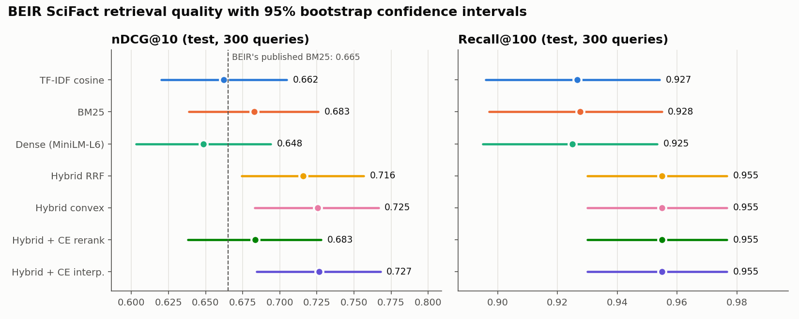
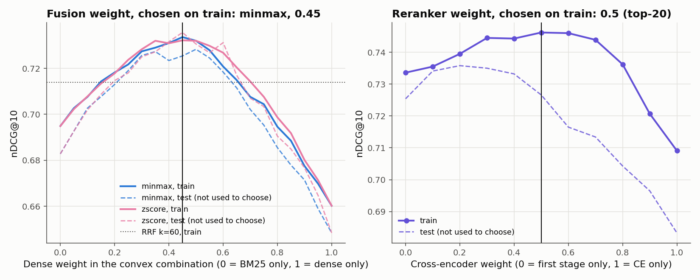
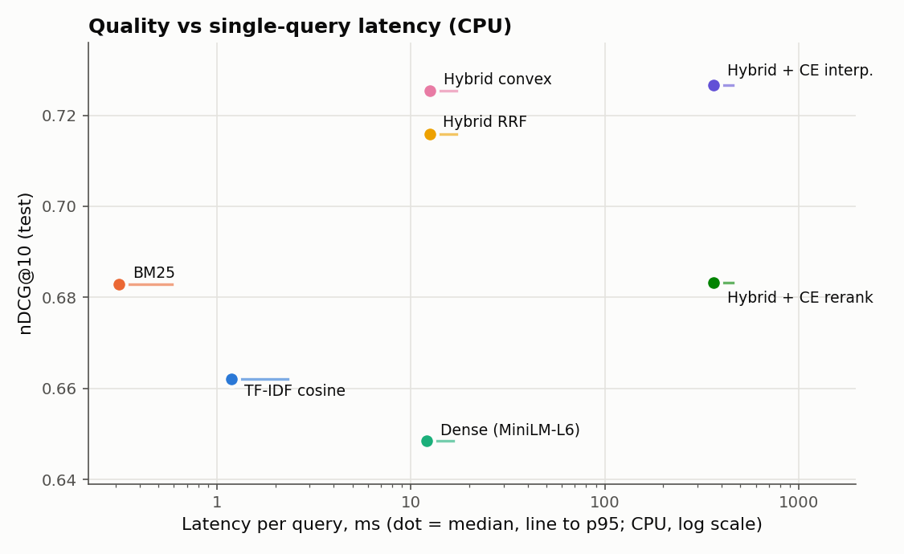
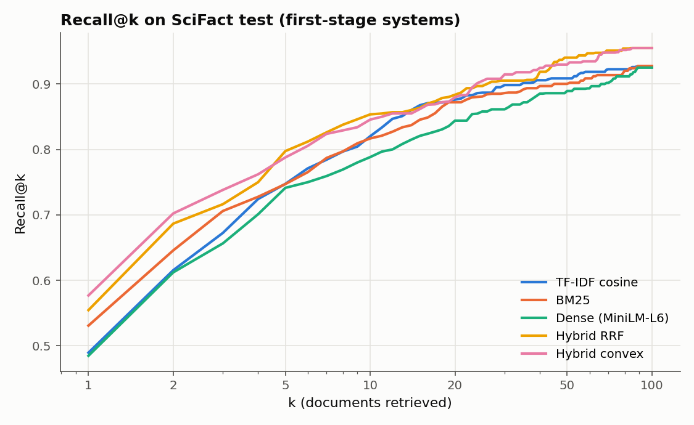

# Hybrid Search RAG (`hybridrag`)

The retrieval half of a retrieval-augmented generation (RAG) system, **measured, not assumed**:
BM25 from scratch, dense embeddings, hybrid fusion and cross-encoder reranking, evaluated on the
public BEIR SciFact benchmark. An answer layer for Claude that cites its sources is included; it
is tested with a mocked client only and has not been run against the API.

[](https://github.com/faiqrasulov/hybrid-search-rag/actions/workflows/ci.yml)

[](LICENSE)

## Key results

BEIR SciFact: 5,183 scientific abstracts, 300 test
claims with expert relevance judgements. Every tunable choice (fusion weight and normalisation,
which first stage to rerank, the reranker weight, BM25 variants) was made on the separate
**train** split (809 queries); the test split was only scored. All
numbers come from `make run` and are stored in [`reports/metrics.json`](reports/metrics.json).

| System (test, 300 queries) | nDCG@10 [95% CI] | Recall@100 | Recall@10 | MRR@10 | Latency p50 / p95 (ms) |
|---|---|---:|---:|---:|---:|
| TF-IDF cosine | 0.662 [0.620, 0.705] | 0.927 | 0.820 | 0.620 | 1.2 / 2.3 |
| BM25 | 0.683 [0.639, 0.726] | 0.928 | 0.817 | 0.645 | 0.31 / 0.59 |
| Dense (MiniLM-L6) | 0.648 [0.603, 0.694] | 0.925 | 0.788 | 0.607 | 12 / 17 |
| Hybrid RRF | 0.716 [0.674, 0.757] | 0.955 | 0.854 | 0.679 | 12 / 17 |
| Hybrid convex | 0.725 [0.683, 0.766] | 0.955 | 0.846 | 0.694 | 13 / 17 |
| Hybrid + CE rerank | 0.683 [0.638, 0.728] | 0.955 | 0.810 | 0.651 | 364 / 456 |
| Hybrid + CE interp. | 0.727 [0.684, 0.768] | 0.955 | 0.850 | 0.693 | 364 / 456 |

- **Hybrid search is what moves the metric.** BM25 + MiniLM embeddings fused by a convex combination
  (dense weight 0.45, min-max normalisation, chosen on train) reach
  nDCG@10 **0.725** vs 0.683 for BM25 alone: +0.043 (95% CI [+0.025, +0.060], Holm p < 0.0001).
  Recall@100 rises from 0.928 to 0.955. Because the fusion weight is tuned on SciFact train
  queries, 0.725 is not a zero-shot BEIR number; untuned RRF (0.716) is the figure to compare
  with published zero-shot results.
- **BM25 written from scratch matches Lucene.** 0.683 nDCG@10 / 0.928
  Recall@100, against 0.679 / 0.925 for Lucene BM25 on the same
  single-field setup (Pyserini). BEIR's published 0.665 comes from a
  two-field index (explained [below](#bm25-from-scratch-vs-the-published-baselines)).
- **An off-the-shelf cross-encoder made results worse.** Reranking the hybrid's top
  20 with `ms-marco-MiniLM-L-6-v2` lowers nDCG@10 to 0.683, a change of
  -0.042 (95% CI [-0.069, -0.015], Holm p 0.015), at 29x the median latency. Interpolating its
  scores with the first stage (weight tuned on train) only brings it back to the hybrid's level
  (0.727). The reranker reads only the first 256 tokens of each passage, which cuts off most
  SciFact abstracts, so part of the gap may come from truncation rather than from the model.
- **Dense retrieval alone is not enough on scientific claims**: MiniLM scores 0.648,
  below BM25 by -0.034 (95% CI [-0.070, +0.000], Holm p 0.162), yet it carries information BM25 misses: fusing the
  two beats both.



## Problem & why it matters

Most RAG demos connect an embedding model to an LLM and judge the result by reading a few answers.
But the model can only ground its answer in what retrieval hands it: if the supporting document
is not in the top k, the best possible outcome is "not enough evidence", and the usual outcome is
a fluent answer built on the wrong passages. **Retrieval quality caps answer quality**, and unlike
answer quality it is cheap to measure: public benchmarks ship relevance judgements, and standard
metrics (nDCG, Recall, MRR) turn them into numbers that can be compared with confidence intervals.

This project treats retrieval as the part to engineer and measure. It asks the questions a team
building search over specialised text (research papers here; equally contracts, support tickets
or internal documentation) has to answer before shipping: is a dense model better than keyword
search on our vocabulary? Is hybrid search worth the extra embedding call? Does a reranker pay for
its latency? The answers on SciFact are not the ones the usual defaults would suggest.

## Approach

```
query ─┬─ BM25 (scipy sparse, from scratch) ─────────────┐
       └─ MiniLM-L6 query embedding -> exact cosine search ┴─ fusion (RRF or convex)
             -> top-100 -> [cross-encoder on top-20] -> top-k passages -> Claude, citing [doc_id]
```

| Module | What it does | Key design decisions |
|---|---|---|
| `text.py` | Tokenizer | Lowercase, Unicode word split, possessive removal, Lucene's 33-word English stop list, Porter stemming via the pure-Python `snowballstemmer` (the stemmer family Elasticsearch's `english` analyzer uses) |
| `lexical.py` | Okapi BM25 and TF-IDF cosine, from scratch | One CSR term-count matrix; BM25 weights are precomputed into a term x document matrix, so scoring a batch of queries is one sparse matrix product. Lucene's idf `ln(1 + (N - df + 0.5) / (df + 0.5))`, k1 = 1.2, b = 0.75. TF-IDF uses sublinear tf and smoothed idf |
| `dense.py` | Sentence-transformer retrieval | `all-MiniLM-L6-v2`, L2-normalised float32 embeddings, cached as `.npy` keyed by model name and a hash of the corpus text, embedded in chunks of 256 to bound memory. Exact search is one matrix-vector product |
| `fusion.py` | RRF and convex combination | RRF (k = 60) uses ranks only, so it needs no calibration. The convex combination needs per-query normalisation (min-max or z-score over each retriever's top 100); a document missing from one list gets that list's lowest score |
| `rerank.py` | Cross-encoder reranking | `cross-encoder/ms-marco-MiniLM-L-6-v2` on the top 20 (max 256 tokens per pair, CPU budget); optional interpolation of z-scored logits with first-stage scores |
| `metrics.py` | nDCG@k, Recall@k, MRR@k, bootstrap | trec_eval conventions (linear gains, ideal DCG from all judged documents). Paired bootstrap over queries (10,000 resamples shared by all systems), shifted-bootstrap p-values, Holm correction across the comparison family |
| `evaluate.py` | The protocol | Tune on train, score on test; latency measured query by query, as an online system would run; numpy's BLAS pinned to one thread (see Lessons) |
| `rag.py`, `cli.py` | Answer layer and CLI | `hybridrag.answer(question)` returns answer text, parsed `[doc_id]` citations and the passages; the CLI prints the passages when no API key is set |

**Why exact search and not FAISS/HNSW.** For 5,183 documents x 384 dimensions, brute force is a
single 2-million multiply-add product: 0.43 ms median including top-100
selection, with exact results. An approximate index starts to pay off around a million documents,
where the float32 matrix is about 1.5 GB and brute force costs tens of milliseconds per query;
HNSW then trades a little recall for sub-millisecond search.

**What is tested** (42 tests, about 3 s, no network): nDCG/Recall/MRR on
hand-computed cases and against scikit-learn's `ndcg_score`; BM25 on a hand-computed 3-document
corpus and against a loop-based textbook implementation for four (k1, b) settings; TF-IDF against
scikit-learn's `TfidfVectorizer`; RRF and convex fusion on hand-computed lists; the bootstrap
against the normal-theory interval; Holm against known values; the answer layer with a mocked
Anthropic client; the CLI without an API key; and the full pipeline end to end on a synthetic
corpus with a deterministic fake encoder and reranker (no model downloads).

## Results

### Which differences are real

Paired bootstrap over the 300 test queries (10,000 resamples). Holm-adjusted p-values
control the family-wise error over the eight comparisons of each metric.

| Comparison | Delta nDCG@10 [95% CI] | p | p (Holm) | Delta Recall@100 | p (Holm) |
|---|---|---:|---:|---:|---:|
| BM25 vs TF-IDF cosine | +0.021 [+0.001, +0.041] | 0.038 | 0.152 | +0.001 | 1.000 |
| Dense (MiniLM-L6) vs BM25 | -0.034 [-0.070, +0.000] | 0.054 | 0.162 | -0.003 | 1.000 |
| Hybrid RRF vs BM25 | +0.033 [+0.010, +0.056] | 0.005 | 0.025 | +0.027 | 0.126 |
| Hybrid convex vs BM25 | +0.043 [+0.025, +0.060] | < 0.0001 | < 0.0001 | +0.027 | 0.126 |
| Hybrid convex vs Dense (MiniLM-L6) | +0.077 [+0.050, +0.105] | < 0.0001 | < 0.0001 | +0.030 | 0.126 |
| Hybrid convex vs Hybrid RRF | +0.009 [-0.006, +0.025] | 0.223 | 0.447 | +0.000 | 1.000 |
| Hybrid + CE rerank vs Hybrid convex | -0.042 [-0.069, -0.015] | 0.003 | 0.015 | +0.000 | 1.000 |
| Hybrid + CE interp. vs Hybrid convex | +0.001 [-0.014, +0.016] | 0.878 | 0.878 | +0.000 | 1.000 |

The per-system intervals in the table at the top are wide (about +-0.04) because 300 queries
is a small test set; paired comparisons are much tighter, because the same hard queries are hard
for every system. Hybrid convex beats BM25, dense, and the cross-encoder rerank clearly; its edge
over RRF (+0.009) is not significant.

### BM25 from scratch vs the published baselines

| BM25 variant (test) | nDCG@10 | Note |
|---|---:|---|
| This repo: title + abstract as one field, Porter, k1 = 1.2, b = 0.75 | 0.683 | default |
| Lucene BM25, same single field (Pyserini "flat") | 0.679 | published |
| BEIR paper, Elasticsearch, title and abstract as two fields | 0.665 | published |
| Lucene BM25, two fields (Pyserini "multifield") | 0.665 | published |
| This repo: two fields combined like BEIR's query (`best_fields`, tie-breaker 0.5) | 0.687 | ablation |
| This repo: no stemming | 0.666 | ablation (-0.016, p = 0.073) |
| This repo: k1 = 1.2, b = 0.5 (best of a 5 x 5 grid on train) | 0.679 | ablation (-0.004, p = 0.347) |

The from-scratch BM25 agrees with Lucene on the same setup to within 0.004
nDCG@10 and 0.003 Recall@100; small
differences in tokenisation (Lucene's standard tokenizer vs a regex) and Lucene's lossy one-byte
encoding of document length are expected to account for that. In Lucene, indexing title and
abstract as separate fields lowers the score: Pyserini's two-field run gets 0.665, the same as
BEIR's Elasticsearch number. An emulation of BEIR's two-field query did **not** reproduce
that drop (0.687). The cause was not investigated; one candidate is how Lucene
normalises the length of very short fields such as titles. Tuning k1 and b on train did not
transfer to test, and stemming helped by +0.016 (not significant at 300
queries, but consistent with the train split: 0.695 vs
0.667).

### Fusion: tuned on train, reported on test



The convex combination was tuned over 21 dense weights x 2 normalisations on the train split
(0.734 train nDCG@10 at min-max, weight 0.45). The dashed test
curves are shown for transparency only. The chosen setting scores 0.725 on test; the
best point of the test grid would have been 0.736 (z-score, 0.45),
but choosing it would have been tuning on the test set. The top of the curve is broad: every dense weight from 0.3 to 0.55,
with either normalisation, beats RRF on both splits. So the exact weight matters less than
combining the two retrievers at all, and RRF, which needs no tuning, gets most of the gain
(0.716).

### Reranking: depth, interpolation and latency

nDCG@10 on test when the cross-encoder reranks the top-d hybrid candidates:

| Depth d | Cross-encoder order | Interpolated (weight 0.5) |
|---:|---:|---:|
| 5 | 0.706 | 0.723 |
| 10 | 0.699 | 0.726 |
| 15 | 0.690 | 0.729 |
| 20 | 0.683 | 0.727 |

The MS MARCO cross-encoder gets **worse the more candidates it sees**: it was trained on web
search queries, and SciFact's inputs are scientific claims judged by whether an abstract supports
or refutes them, a different notion of relevance. On train the interpolation weight
0.5 gained +0.013 nDCG@10 over
the hybrid; on test it gained +0.001, i.e. nothing measurable, for
353 ms of extra latency per query.

### Latency



Single-query latency on a laptop CPU (Apple M3, PyTorch with 4 threads, median and p95 over the
300 test queries; absolute numbers vary with machine load):

| Stage | Median (ms) | p95 (ms) |
|---|---:|---:|
| BM25 (tokenize + sparse product + top-100) | 0.31 | 0.59 |
| TF-IDF cosine | 1.2 | 2.3 |
| MiniLM query embedding | 12 | 16 |
| exact cosine search over 5,183 vectors + top-100 | 0.43 | 1.1 |
| RRF fusion | 0.08 | 0.11 |
| convex fusion | 0.15 | 0.19 |
| cross-encoder, 20 pairs | 353 | 442 |

Hybrid search costs one query embedding (about 12 ms) on top of BM25's
0.31 ms; the fusion itself is negligible. The cross-encoder dominates everything
else by an order of magnitude.



## Lessons: what actually moved the metrics

1. **Fusing lexical and dense retrieval** was the single largest gain:
   +0.043 nDCG@10 over BM25 and +0.077 over dense, with
   +0.027 Recall@100. The two retrievers fail on different
   queries; neither is a substitute for the other.
2. **Stemming** helped BM25 (+0.016) for free. Tuning k1/b did not.
3. **The fusion method mattered less than fusing at all.** Untuned RRF gets
   +0.033 over BM25; the tuned convex combination adds a further
   +0.009 (not significant). Min-max and z-score normalisation peaked at the
   same train score (0.734 vs 0.732).
4. **A reranker is a hypothesis to test, not a default.** The popular MS MARCO cross-encoder lowered
   nDCG@10 by 0.042 on this domain; tuned interpolation only neutralised the
   damage. A reranker trained on in-domain data would be the thing to try next.
5. **Train-to-test transfer must be checked.** The reranker weight that helped on 809 train
   queries did not help on test; the fusion weight did transfer. With 300 test queries only the
   paired comparisons resolve differences of 0.01-0.02.
6. **An engineering bug can look like a model cost.** The first latency run showed several
   milliseconds for a dense search that takes a fraction of a millisecond in isolation: numpy's
   OpenBLAS thread pool and PyTorch's oversubscribe the CPU when they are called alternately.
   `make run` re-measures this on 30 queries with BLAS left at 8
   threads vs pinned to one (`threadpoolctl`): query embedding 13 ->
   11 ms, dense search
   11 -> 0.44 ms
   (p95 22 -> 1.0 ms),
   cross-encoder 559 -> 326 ms (medians).

## The answer layer (RAG)

`hybridrag.answer(question)` retrieves the top-k passages (hybrid by default) and sends them to
Claude through the official `anthropic` SDK:

- **Grounded prompt.** Passages go first, each wrapped as `<passage id="...">`, then the question.
  The system prompt requires a `[doc_id]` citation after every claim, only ids that were provided,
  no outside knowledge, and a reply starting "Not enough evidence" when the passages do not
  support an answer. Passage text is declared to be data, not instructions.
- **Checked citations.** `Answer.citations` holds cited ids that match a retrieved passage;
  `Answer.invalid_citations` flags ids the model cited but was never shown.
- **Configuration.** Model from `--model` or `HYBRIDRAG_MODEL` (default `claude-opus-5-5`, with
  adaptive thinking at `effort: medium`). For models that support it, the request opts into the API's
  server-side refusal fallback; a refusal is reported in the result, not parsed as an answer.
- **No API calls in this repo's results.** Tests use a mocked client; no generated answers are
  shown here. Without `ANTHROPIC_API_KEY` the CLI degrades to showing the retrieved passages:

```text
$ hybridrag answer "Do diabetic patients with acute coronary syndrome have a higher risk of bleeding?" -k 3
 1. [23783727] Ticagrelor vs. clopidogrel in patients with acute coronary syndromes and diabetes: a substudy from the PLATelet inhibition and patient Outcomes (PLATO) trial  (score 1.000)
    AIMS patients with diabetes mellitus (DM) have high platelet reactivity and are at increased
    risk of ischaemic events and bleeding post-acute coronary syndromes (ACS). In the PLATelet
    inhibition and patient Outcomes (PLATO) trial, ticagrelor reduced the primary composite endpoint
    of cardiovascular ...
 2. [5884524] Impact of diabetes on long-term prognosis in patients with unstable angina and non-Q-wave myocardial infarction: results of the OASIS (Organization to Assess Strategies for Ischemic Syndromes) Registry.  (score 0.854)
    BACKGROUND Although unstable coronary artery disease is the most common reason for admission to
    a coronary care unit, the long-term prognosis of patients with this diagnosis is unknown. This
    is particularly true for patients with diabetes mellitus, who are known to have a high morbidity
    and ...
 3. [29253460] Sex-related differences in the presentation, treatment and outcomes among patients with acute coronary syndromes: the Global Registry of Acute Coronary Events.  (score 0.654)
    OBJECTIVE To assess whether sex differences exist in the angiographic severity, management and
    outcomes of acute coronary syndromes (ACS). METHODS The study comprised 7638 women and 19 117
    men with ACS who underwent coronary angiography and were included in GRACE (Global Registry of
    Acute Coronary ...

Note: ANTHROPIC_API_KEY is not set, so no answer was generated. These are the passages that would be sent to claude-opus-5-5; set the key to get an answer that cites them by [doc_id].
```

```python
from hybridrag import answer

result = answer("Does the APOE4 allele raise Alzheimer's risk?", k=5)  # needs ANTHROPIC_API_KEY
result.text                 # the model's answer, with [doc_id] after each claim
result.citations            # e.g. ["4983", ...]: cited ids that were among the passages
result.invalid_citations    # cited ids that were not retrieved (should be empty)
result.passages             # the Hit objects (doc_id, title, text, score) that were sent
```

## Quickstart

```bash
git clone https://github.com/faiqrasulov/hybrid-search-rag.git
cd hybrid-search-rag
make install          # pip install -e ".[dev]"
make run              # download SciFact, index, embed, tune on train, evaluate on test,
                      # bootstrap, latency -> reports/metrics.json + reports/figures/
make test             # 42 tests, ~3 s, no network
```

`make install` takes the newest compatible packages. To reproduce the committed `reports/`, use
`make install-locked` instead: it installs the versions pinned in
[`requirements.lock`](requirements.lock) (Python 3.12). With them `make run` regenerates every retrieval
metric, confidence interval and p-value in `reports/metrics.json` exactly; the latency figures
depend on the machine (checked on macOS arm64).

```bash
hybridrag search "statins reduce the risk of heart attack" --system hybrid -k 5
hybridrag search "statins reduce the risk of heart attack" --system rerank
hybridrag answer "Do statins reduce the risk of heart attack?"   # cites [doc_id]s if ANTHROPIC_API_KEY is set
```

`make run` took 8.2 minutes wall-clock on the laptop CPU described above, including
66 s to build the indexes and embed the corpus (embeddings are cached in
`data/embeddings/` afterwards), with a peak of
545 MB RAM. The MiniLM and cross-encoder models (about 90 MB each) are downloaded from the
Hugging Face Hub on first use.

## Project structure

```
src/hybridrag/
  data.py        BEIR SciFact download (checksum, safe extraction) and loading
  text.py        tokenizer: stopwords, Porter stemming
  lexical.py     BM25 and TF-IDF on scipy sparse matrices
  dense.py       sentence-transformer encoder, embedding cache, exact cosine search
  fusion.py      reciprocal rank fusion, min-max / z-score convex combination
  rerank.py      cross-encoder reranking and score interpolation
  ranking.py     ranked-list type and deterministic top-k
  engine.py      SearchEngine: one interface over all systems
  metrics.py     nDCG, Recall, MRR, paired bootstrap, Holm
  evaluate.py    the full protocol -> reports/metrics.json
  figures.py     report figures
  rag.py         grounded Claude answer layer with citation checking
  cli.py         hybridrag search | answer | evaluate | download
reports/         metrics.json and figures written by `make run`
tests/           42 pytest tests (fake encoder and reranker, mocked Anthropic client)
```

## Limitations & next steps

- **Small test set.** 300 queries give per-system CIs of about +-0.04 nDCG@10; only paired tests
  separate close systems, and the reranker-weight result shows how easily train gains vanish.
- **One small dense model.** `BAAI/bge-small-en-v1.5` scores higher on BEIR, but it has twice
  MiniLM-L6's layers and twice its maximum input length, so embedding the corpus on CPU takes
  several times longer; it was left out to keep `make run` within its time budget. Next: add it
  (embeddings are cached after the first run) and test biomedical encoders.
- **Reranker depth and length.** The cross-encoder sees only the top 20 candidates
  truncated to 256 tokens, to fit the CPU budget; most abstracts are longer than that. An in-domain or LLM reranker is the obvious next
  experiment.
- **The answer layer is not evaluated.** No paid API calls were made. SciFact also labels whether
  each abstract supports or refutes a claim and marks rationale sentences, which would allow
  measuring citation precision and faithfulness of the generated answers.
- **Not a production service.** The BM25 index is rebuilt in memory at start-up (a few seconds;
  embeddings load from the cache); there is no ANN index, sharding or incremental indexing.

## Data & references

**Data.** BEIR SciFact, downloaded at runtime from the official BEIR mirror
(`https://public.ukp.informatik.tu-darmstadt.de/thakur/BEIR/datasets/scifact.zip`, MD5-checked) into `data/` and never committed. The SciFact dataset is
licensed **CC BY-NC 2.0** (non-commercial use).

- Wadden, Lin, Lo, Wang, van Zuylen, Cohan & Hajishirzi (2020). *Fact or Fiction: Verifying
  Scientific Claims.* EMNLP. (SciFact)
- Thakur, Reimers, Rücklé, Srivastava & Gurevych (2021). *BEIR: A Heterogeneous Benchmark for
  Zero-shot Evaluation of Information Retrieval Models.* NeurIPS Datasets and Benchmarks.
- Robertson & Zaragoza (2009). *The Probabilistic Relevance Framework: BM25 and Beyond.*
  Foundations and Trends in Information Retrieval.
- Cormack, Clarke & Büttcher (2009). *Reciprocal Rank Fusion outperforms Condorcet and individual
  Rank Learning Methods.* SIGIR.
- Reimers & Gurevych (2019). *Sentence-BERT: Sentence Embeddings using Siamese BERT-Networks.*
  EMNLP. Wang et al. (2020). *MiniLM: Deep Self-Attention Distillation.* NeurIPS.
- Nogueira & Cho (2019). *Passage Re-ranking with BERT.* arXiv:1901.04085. Bajaj et al. (2016).
  *MS MARCO: A Human Generated MAchine Reading COmprehension Dataset.*
- Järvelin & Kekäläinen (2002). *Cumulated gain-based evaluation of IR techniques.* ACM TOIS. (nDCG)
- Efron & Tibshirani (1993). *An Introduction to the Bootstrap.* Sakai (2006). *Evaluating
  evaluation metrics based on the bootstrap.* SIGIR. Holm (1979). *A simple sequentially
  rejective multiple test procedure.* Scand. J. Statistics.
- Lin et al. (2021). *Pyserini: A Python Toolkit for Reproducible Information Retrieval Research.*
  SIGIR. (Lucene BM25 reference numbers for BEIR)

## License

MIT, see [LICENSE](LICENSE). The SciFact data is not included and keeps its own license.
